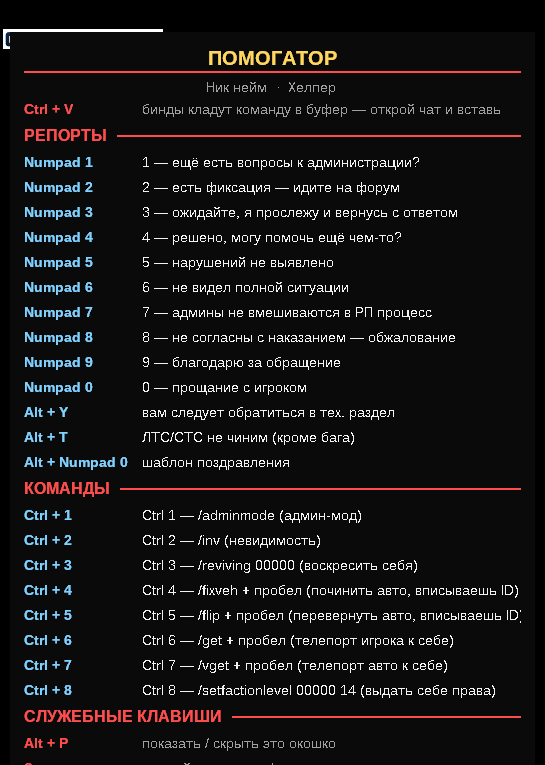
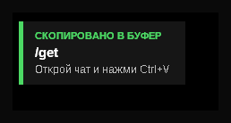
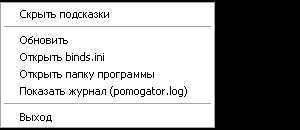

# Помогатор 1.0 — биндер-буфер для админки GTA (MTA / NextRP)

Лёгкая утилита для Windows: **биндер, который не печатает в игру, а кладёт готовую команду
в буфер обмена.** Ты сам открываешь чат и жмёшь `Ctrl+V` — для игры это обычная вставка,
ничего похожего на бота.

Замена AHK-скриптам: один `.exe`, настройки в обычном текстовом `binds.ini`, значок в трее,
окошко с подсказками по `Alt+P`.

<p align="center">
  
</p>

---

## Возможности

- **Ничего не нажимает в игру** — ноль вызовов `SendInput`. Только `SetClipboardData`.
- **Не засоряет историю `Win+V`** — команды не попадают ни в историю, ни в облако
  (форматы `CanIncludeInClipboardHistory` и `CanUploadToCloudClipboard`).
- **Команды со слэшем** — вставляются и в чат, и в строку репорта.
- `{space}` на конце — `/get{space}` даёт `/get ` с пробелом, чтобы сразу вписать ID.
- Переменные `{my_id}`, `{Пол}`, `{nick}`, `{rank}`.
- Плашка «СКОПИРОВАНО В БУФЕР» и звук — включаются и выключаются по отдельности в конфиге.
- Окошко со всеми подсказками (`Alt+P`), настраиваемый вид и положение.
- Конфиг правится Блокнотом, перечитывается из трея без перезапуска.
- Без установки, без драйверов, без прав администратора.

<p align="center">
  
</p>

---

## Быстрый старт

1. Скачай архив из [Releases](../../releases/latest) и распакуй в любую папку
   (например `C:\Pomogator`).
2. Открой `binds.ini`: впиши свой ник (`nick`), звание (`rank`) и игровой ID (`my_id`).
3. Запусти `Pomogator.exe`. Рядом появится `pomogator.log` и значок в трее.
4. В игре: открываешь чат → жмёшь бинд (`Ctrl+1`, `Numpad 5`, `Alt+T`…) → `Ctrl+V` → `Enter`.

**Меню в трее:** правый клик по значку → «Обновить» (перечитать `binds.ini` после правок),
«Открыть binds.ini», «Открыть папку программы», «Показать журнал», «Выход».

---

## Бинды по умолчанию

### Команды

| Клавиша | В буфер |
|---|---|
| `Ctrl+1` | `/adminmode` |
| `Ctrl+2` | `/inv` |
| `Ctrl+3` | `/reviving {my_id}` |
| `Ctrl+4` | `/fixveh ` |
| `Ctrl+5` | `/flip ` |
| `Ctrl+6` | `/get ` |
| `Ctrl+7` | `/vget ` |
| `Ctrl+8` | `/setfactionlevel {my_id} 14` |

### Репорты

| Клавиша | Про что |
|---|---|
| `Numpad 1` | ещё есть вопросы к администрации? |
| `Numpad 2` | есть фиксация — идите на форум |
| `Numpad 3` | ожидайте, я прослежу и вернусь с ответом |
| `Numpad 4` | решено, могу помочь ещё чем-то? |
| `Numpad 5` | нарушений не выявлено |
| `Numpad 6` | не видел полной ситуации |
| `Numpad 7` | админы не вмешиваются в РП процесс |
| `Numpad 8` | не согласны с наказанием — обжалование |
| `Numpad 9` | благодарю за обращение |
| `Numpad 0` | прощание с игроком |
| `Alt+Y` | обратитесь в тех. раздел (контакты ТП) |
| `Alt+T` | ЛТС/СТС не чиним (кроме бага) |
| `Alt+Numpad0` | шаблон поздравления |

Служебное: `Alt+P` — показать/скрыть окошко с подсказками.

---

## Настройка

Всё лежит в `binds.ini` (UTF-8). После правок — правый клик по значку → «Перечитать binds.ini».

```ini
[settings]
nick = Ник нейм        ; впиши свой ник
rank = Хелпер
my_id = 00000          ; впиши свой игровой ID

copy_toast = true      ; плашка «скопировано»: true — показывать, false — выключить
copy_beep = true       ; звук: true — включён, false — тихо
copy_toast_ms = 1600   ; сколько держать плашку, мс
copy_no_history = true ; не засорять Win+V

toggle_hint = alt+p    ; пусто — отключить

[bind]
key = ctrl+alt+n       ; ctrl+1, alt+u, alt+з, numpad7, shift+f5, alt+numpad0
group = Мои команды    ; заголовок раздела в окошке
hint = что делает      ; строка в окошке
send = /weapongive {my_id} 38 500
```

Внутри `send` работают `{space}`, `{enter}`, `{tab}` и переменные `{my_id}`, `{Пол}`.

| Настройка | Смысл |
|---|---|
| `nick`, `rank` | твой ник и звание в шапке окошка (по умолчанию заглушка «Ник нейм») |
| `my_id` | игровой ID для подстановки `{my_id}` |
| `copy_toast` | плашка «СКОПИРОВАНО В БУФЕР»: `true` (по умолчанию) / `false` — выключить |
| `copy_beep` | звук при копировании: `true` (по умолчанию) / `false` — тихо |
| `copy_toast_ms` | сколько держать плашку, мс |
| `copy_no_history` | не добавлять в историю `Win+V` и облако |
| `hint_font`, `hint_size`, `hint_x`, `hint_y`, `hint_alpha` | вид и место окошка |
| `hint_bg`, `title_color`, `group_color`, `key_color`, `text_color` | цвета (`RRGGBB`) |
| `hint_show_on_start`, `hint_start_hide_ms` | показать при запуске и спрятать через N мс |
| `toggle_hint` | клавиша «показать/скрыть подсказки» |
| `only_when_window` | бинды только при активном окне с этим словом в заголовке |
| `tray_notify_on_start` | подсказка от значка при запуске |

<p align="center">
  
</p>

---

## Сборка из исходников

Нужен только [Go](https://go.dev/dl/) 1.22+ (Windows, amd64).

```bat
build.bat
```

или вручную:

```bat
cd source
go build -trimpath -ldflags "-s -w -H windowsgui" -o ..\Pomogator.exe .
```

Иконка и манифест уже скомпилированы в `source\rsrc_windows_amd64.syso`, поэтому `windres`
не требуется. Пересобрать ресурсы (если менял иконку/манифест):

```bat
windres -i pomogator.rc -o rsrc_windows_amd64.syso -O coff -I .
```

Тесты: `cd source && go test ./...`

---

## Как это устроено

- **Копирование:** `OpenClipboard` → `EmptyClipboard` → `SetClipboardData(CF_UNICODETEXT)` →
  два служебных формата (`DWORD 0`) → `CloseClipboard`. Подробный разбор приёма —
  в [docs/clipboard-no-history.md](docs/clipboard-no-history.md).
- **Перехват клавиш:** `WH_KEYBOARD_LL` (как в AHK); если хук не установился —
  автоматический откат на `RegisterHotKey`. Комбинация «проглатывается», чтобы не улетела
  в игру.
- **Чего нет:** драйверов, внедрения DLL, правки памяти игры, `SendInput`.

---

## Про античит

Встроенный античит MTA (сообщения вида `SD #4 BOT` / `AC #4`) реагирует на поведение
программ: глобальные хуки, окна поверх игры, синтетический ввод и особенно на сторонние
драйверы клавиатуры/мыши.

- Драйверов в проекте нет и не будет.
- `SendInput` не вызывается ни разу.
- Права администратора не запрашиваются. Но они нужны для корректной работы с NextRP

> Проект не обходит защиты и не прячется от античита — это принципиально. Если сервер
> запрещает автоматизацию, используй утилиту только там, где это разрешено.

---

## Лицензия

[MIT](LICENSE). Используй как хочешь, только не продавай как свой продукт :)
